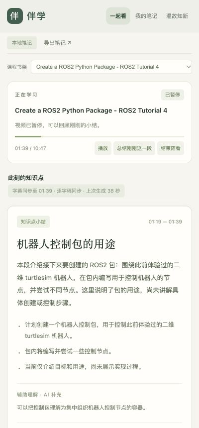

# 伴学 · YouTube 中文陪看

在 YouTube 看课程时，点一下 Chrome 右上角的「伴学」，就在侧栏跟随当前视频生成中文知识点卡片。把有用的卡片保存成笔记，之后用问答方式复习，也能点时间戳回到老师的讲解。

不用每次复制视频链接，也不用注册 KeepFrame 等其他总结服务的账户。AI 生成使用你已经登录的 **ChatGPT / Codex 账户及其额度**。



*上图是侧栏界面的本地预览；真实 Chrome 扩展使用同一套界面。*

## 能做什么

- **点一下开始**：连接当前 YouTube 视频，保留当前播放进度；本地服务未运行时自动启动。
- **跟随播放**：从字幕积累已观看的一小段讲解，生成中文概述、关键点、辅助理解和自测题。
- **有依据的卡片**：保留时间范围和字幕摘录；字幕不清楚时显示待核对提示，AI 补充例子单独标注。
- **保存与回看**：按课程保留卡片，收藏、搜索、写自己的笔记，导出带时间戳链接的 Markdown。
- **问答复习**：先回答问题再揭示答案，根据「还没记住 / 有点模糊 / 记住了 / 很熟悉」安排下一次复习。
- **本地 MCP**：其他支持 MCP 的助手可以读取正在看的课程上下文、添加卡片和跳转时间戳。

## 当前状态

这是一个可运行的实验版本，已在 **macOS + Google Chrome** 中验证扩展点击、当前视频连接、自动启动、字幕卡片、笔记和复习流程。当前一键安装只支持这个组合，尚未完成 Windows、Linux、Edge 或其他 Chromium 浏览器的安装适配。

它根据字幕分段总结，**还不能保证精准判断每个知识点讲完的瞬间**。目前不直接理解视频画面、板书、机器人演示或没有念出来的公式，也没有内置无字幕音频转写。

## 安装一次，以后直接点扩展

### 1. 准备本地依赖

需要：

- [Node.js](https://nodejs.org/) **22 或更新版本**。
- Google Chrome **116 或更新版本**。
- 已使用 ChatGPT 账户登录的 [Codex CLI](https://github.com/openai/codex)。本项目会优先寻找 Codex 桌面版内置 CLI，也可使用 PATH 中的 `codex`。
- [OpenCLI MCP](https://github.com/jackwener/opencli-mcp) 及其 Chrome 扩展，负责读取视频页面与字幕。

先安装浏览器连接：

```sh
npm install -g opencli-mcp
opencli-mcp setup --clients none
```

然后安装 [OpenCLI MCP Chrome 扩展](https://chromewebstore.google.com/detail/opencli-mcp/lnaoghmfcdnbhgcihkakfobckmfhllkg)，按照扩展提示连接本地组件。检查连接：

```sh
opencli-mcp doctor
```

应看到浏览器扩展已连接。`--clients none` 只准备本地连接，不修改其他客户端的 MCP 配置。

如果还没有 Codex CLI，可按[官方安装说明](https://github.com/openai/codex#installing-and-running-codex)安装并登录：

```sh
npm install -g @openai/codex
codex login
codex login status
```

选择 ChatGPT 登录。目前项目检查的是这种登录方式，不支持只配置 API key 的运行方式。

**CLI 兼容性：** 实测版本为 `codex-cli 0.162.0-alpha.2`（桌面版内置）。总结调用需要 `codex exec` 支持 `--ignore-user-config`、`--ephemeral`、`--output-schema` 等参数。其他 CLI 版本未逐一验证；如果提示参数无法识别，请使用兼容的 CLI，或通过 `COMPANION_CODEX_BIN` 指定其路径。OpenCLI MCP 实测 npm 版本为 `0.0.27`，项目使用了其内部 host-state 模块，升级后可能需要适配。

### 2. 下载项目，安装本地连接

```sh
git clone https://github.com/GARERYIES/banxue-youtube-companion.git
cd banxue-youtube-companion
npm run install:local
```

也可以从 GitHub 的 **Code → Download ZIP** 下载，解压后双击 `安装本地连接.command`。如果 macOS 拦截未签名脚本，可直接在终端进入解压目录，运行上面的安装命令。

项目本身没有 npm 依赖，不需要运行 `npm install`。这一步会把运行文件复制到 macOS 的应用支持目录，并登记只允许本扩展调用的本地启动器。

### 3. 把伴学加载进 Chrome

1. 打开 `chrome://extensions`，开启右上角「开发者模式」。
2. 点「加载已解压的扩展程序」，选择本项目的 **`extension` 文件夹**，而不是整个项目目录。
3. 在 Chrome 右上角的扩展菜单中，把「伴学 · YouTube 中文陪看」固定到工具栏。

固定扩展 ID 为 `keghlldocdjpnmgjmfcmmeoigegamphg`。请保留 `manifest.json` 中的 `key`：它是公开的扩展识别密钥，不是账户凭据；改动它会让本地启动器的许可不匹配。

## 日常使用

1. 打开一个 YouTube 课程视频，播放到你想开始的位置。
2. 点右上角「伴学」图标，侧栏会连接这个视频，并尝试打开 CC 字幕。
3. 继续观看，积累足够字幕后，小结会自动出现；也可以点「总结刚刚这一段」。
4. 对有价值的卡片点「保存到笔记」，在「我的笔记」中补充自己的理解。
5. 在「温故知新」中进行问答复习，或者导出当前课程的 Markdown 笔记。

同一个已连接标签页切换到下一节 YouTube 视频时，会跟随新视频。想换到另一个标签页，在那个视频页面再点一次「伴学」。关闭侧栏后陪看仍会继续；要停止收集和生成，请点「结束陪看」。

也可以运行 `npm start` 或双击 `启动伴学.command`，然后访问 `http://127.0.0.1:4318`，使用网页界面打开一个独立的视频窗口。

## 延迟与内容边界

- 通常先积累约 **20–35 秒**的讲解，再开始生成。实测两次生成分别约 **19 秒、38 秒**，生成时间之外还有字幕积累时间；网络、Codex 额度和模型负载都会影响延迟。
- 不会每句话都生成一张卡片。当前是字幕长度与播放时间的分段策略，卡片可能覆盖一个知识点的一部分，也可能合并相邻讲解。
- 可在本机缓存整段字幕时间线，但自动总结只向 AI 发送当前播放位置之前已经完成的字幕行。拖动进度后重新分段，避免把跳过的部分混在一起。
- 自动字幕可能误识别术语。公式栏只在字幕明确提到公式时填写，复杂推导仍需结合原视频和讲义核对。
- 目前没有课件 OCR、画面理解、音频转写、云同步或多人共享，也没有上架 Chrome Web Store。

## 数据与权限

**笔记保存在本机，AI 总结通过 Codex 在线生成。** 不向 KeepFrame 等其他总结服务发送内容。提交给 Codex 的内容包含课程标题、当前已观看片段的字幕及时间范围；这不是完全离线的工具。

伴学扩展自身只请求 `activeTab`、`sidePanel`、`storage`、`nativeMessaging`，以及访问 `http://127.0.0.1:4318`。本地启动器只接受固定的启动服务操作；服务只监听回环地址，并限制允许访问的网页和扩展来源。

浏览器连接依赖 **OpenCLI MCP**，它自己的扩展具有更广泛的浏览器权限；请阅读[上游说明](https://github.com/jackwener/opencli-mcp)，决定是否在你的浏览器环境中安装。

| 内容 | 默认位置 |
| --- | --- |
| 安装后的运行文件 | `~/Library/Application Support/Banxue/` |
| 卡片、笔记与字幕缓存 | `~/Library/Application Support/Banxue/data/notebook.json` |
| 本地服务日志 | `~/Library/Application Support/Banxue/data/service.log` |
| 本地启动器日志 | `~/Library/Logs/Banxue/native-host.log` |
| Chrome 本地启动器登记 | `~/Library/Application Support/Google/Chrome/NativeMessagingHosts/com.banxue.companion.json` |

未安装本地连接、直接运行项目时，数据默认保存在项目内的 `data/`。重新安装会更新运行文件并保留已有笔记。仓库忽略数据目录、本机安装配置和日志；发布包不包含个人学习记录或登录信息。

## 常见问题

| 情况 | 处理方式 |
| --- | --- |
| 点扩展后提示本地连接未能启动 | 确認已运行 `npm run install:local`，并加载正确的 `extension` 文件夹；查看本地启动器日志。 |
| OpenCLI 没连接 | 打开 Chrome，运行 `opencli-mcp doctor`，检查 OpenCLI 扩展和本地组件。 |
| 已连接但没有卡片 | 确认视频有可用 CC 字幕，继续播放一段；卡片需要字幕积累和生成时间。 |
| Codex 未登录或额度不足 | 检查 `codex login status` 及账户额度；本工具会消耗你的 Codex 额度。 |
| CLI 提示未知参数 | 对照上面的 CLI 兼容性说明，检查所用版本和二进制路径。 |
| 更新源码后侧栏还是旧版本 | 再运行 `npm run install:local`，在 Chrome 扩展页点「重新加载」；已启动的服务还需要重新启动。 |
| 想备份或迁移笔记 | 复制 `notebook.json`，或者导出 Markdown；默认没有云备份。 |

## 开发与本地 MCP

```sh
npm test
npm start
```

测试覆盖字幕去重、跳转后的分段、只使用已完成字幕、卡片证据校验、复习间隔，以及扩展权限和本地访问来源。真实浏览器与 AI 生成不在单元测试范围内，验证记录见 [docs/verification.md](docs/verification.md)。

主要文件：`extension/` 是 Chrome 侧栏与点击入口，`native/` 是本地启动器，`server.mjs` 负责课程和笔记，`lib/` 负责字幕、浏览器连接与卡片生成，`public/` 是伴学界面。

可把以下配置加入支持 stdio MCP 的客户端，替换项目绝对路径；使用前先让伴学服务运行起来：

```json
{
  "mcpServers": {
    "banxue": {
      "command": "node",
      "args": ["/absolute/path/to/banxue-youtube-companion/mcp.mjs"]
    }
  }
}
```

提供 `lecture_context`、`lecture_add_card`、`lecture_seek` 三个工具。它连接本机服务，不会自动加入你现有的 Codex 对话。

高级配置：`COMPANION_CODEX_BIN` 指定 Codex 可执行文件，`COMPANION_OPENCLI_ROOT` 指定 `opencli-mcp` 包目录，`COMPANION_DATA_DIR` 指定笔记目录，`COMPANION_URL` 指定 MCP 客户端连接地址。这些是进程环境变量；若由 Chrome 自动启动，需要确保启动器能继承它们。扩展默认连接固定端口 `4318`。
